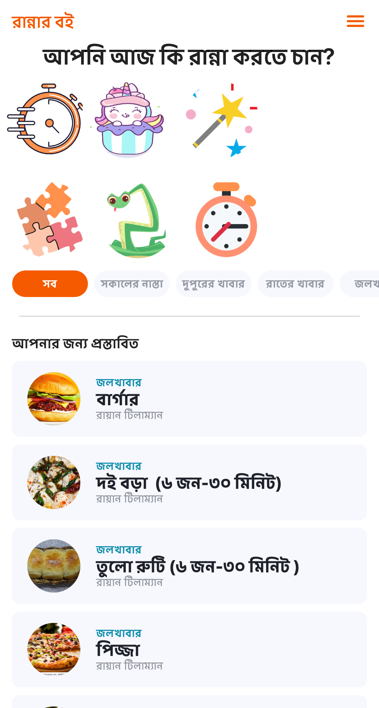

# Bangla Recipe App

A Flutter recipe browser for Bangla-language cooking: browse dishes from a structured JSON dataset, filter by category, and read ingredients and cooking steps with images.

## Screenshot



## Features

- Recipe list with cached network images and category filters (state via `provider`)
- Recipe detail view with ingredients and step-by-step cooking instructions
- Intro slider, splash screen, and countdown cooking timer with local notifications
- Recipe scheduling reminders using `flutter_background_service`
- Firestore-backed recipe data with offline-friendly caching

## Tech stack

Flutter · Dart · Provider · Cloud Firestore · Firebase · flutter_local_notifications · cached_network_image

## How to run

```bash
flutter pub get
flutter run
```

Requires a Flutter SDK (3.x recommended) and, for Firestore features, a Firebase project configured for Android/iOS (`flutterfire configure`).

## License

MIT
